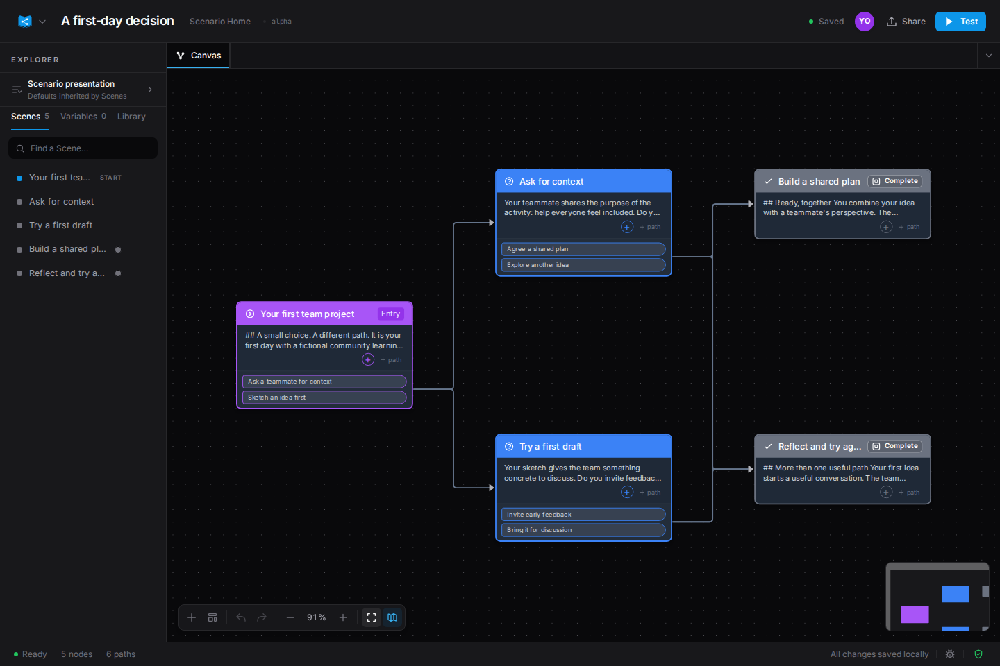
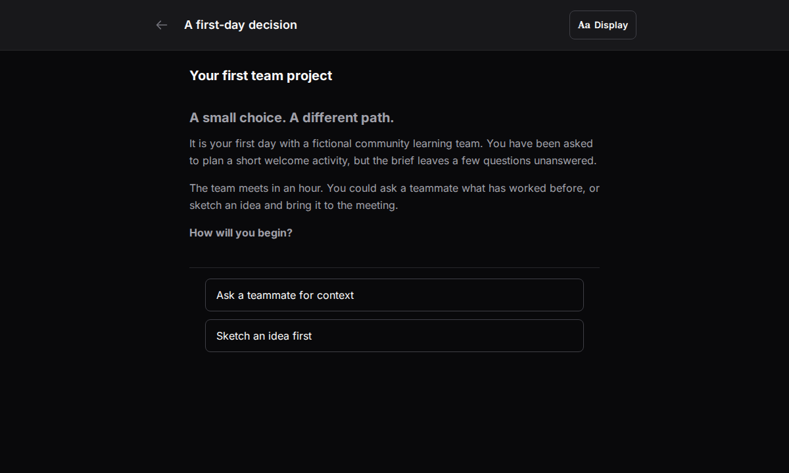

  

<h1 align="center">Cynario</h1>

  <strong>Build and play interactive branching experiences for learning and tabletop exercises—right in your browser.</strong>

Free to use · No account required · Local-first

  <a href="https://cynar.io"><strong>Open Cynario</strong></a> ·
  <a href="https://cynar.io/builder/"><strong>Start building</strong></a> ·
  <a href="https://cynar.io/marketplace/"><strong>Browse examples</strong></a> ·
  <a href="https://cynar.io/use-cases/">Explore use cases</a>

Cynario turns a situation into a set of choices. Map the possible paths, add the content people need, and let them learn by seeing what follows from their decisions. Try another path to compare outcomes—not just check an answer.

## From a branching map to a playable experience

**See the whole story.** Connect scenes on the Builder graph and follow how each choice leads to a different outcome.

**Focus on the decision.** The Player turns the same scenario into a readable experience, one scene and its choices at a time.

Both screenshots show the current app with an authored, fictional onboarding demo—not a real team or incident.

## Build, play, refine, share

1. **Author.** Lay out scenes on a visual graph and connect them with choices.
2. **Play.** Experience the scenario from the learner's perspective.
3. **Iterate.** Test a scene or a whole path, adjust it, and play again.
4. **Share.** Export a file, send an encrypted share link, or co-author live.

Use the same tools for first-day onboarding, classroom lessons, policy practice, incident-response exercises, tabletop discussions, and branching fiction. Start small: one situation, two meaningful choices, and a consequence worth discussing. Add more paths as the learning experience takes shape.

## What you can do today

Mix **six scene modes** in one scenario:

| Mode | What it brings to the experience |
| --- | --- |
| **Decision** | Narrative and choices that lead to different paths. |
| **Slides** | A presentation-style deck inside a scene. |
| **Quiz** | Choices with grading and feedback. |
| **Video** | Time-based video with hotspots to reveal content or branch. |
| **Image** | An image with interactive regions. |
| **Custom** | Direct editing of a scene's underlying source. |

**Logic:** variables, conditions, and effects let earlier choices change what happens later, including scoring and outcomes.

**Media:** add images and video. Uploaded media is stored locally in your browser; externally hosted media stays with its provider.

**Live collaboration:** co-author in real time through direct browser connections or a configured relay. Availability and behavior depend on the device and network.

## Take your work with you

- **`.cynario`** exports the scenario's structure and content as readable JSON. It does **not** include uploaded media.
- **`.cynario.zip`** packages the scenario together with its uploaded media. Use it when those files need to travel with your work.
- **SCORM 1.2** exports a package for a learning management system. Test a small export in your target LMS before relying on it; platforms differ in how they handle SCORM.

## Your data, your responsibility

Cynario is designed to be local-first. Scenarios are stored in your browser, not in a central Cynario account. **No account required does not mean anonymous.**

- **Export regular backups.** Clearing site data or switching devices can lose browser-stored scenarios. Choose `.cynario.zip` when your backup needs uploaded media.
- **Share deliberately.** Encrypted share links protect scenario content while it travels. Complete share links and room links are sensitive access credentials; do not post them publicly.
- **Networks still expose metadata.** Providers may see connection times and addresses even when content is encrypted.
- **External media contacts its provider.** An embedded or hosted video is not isolated from that service.
- **Exports are not automatically encrypted.** Handle exported files and copied content according to their sensitivity.

## Project status and direction

**Cynario is in active development.** The app is available at [cynar.io](https://cynar.io); its interface and features continue to evolve.

Cynario is being built for both browser-based use and self-hosted deployments. **Organization-managed instances, governance controls, and additional deployment options are in development.**

This repository is the public home for bug reports, feature requests, and feedback. **The application source remains private and has not been published here yet.** Source publication is planned in stages. Public self-hosting setup instructions are not provided here yet. See the [public roadmap](https://cynar.io/roadmap/) for the project's direction.

The [LICENSE](LICENSE) file describes the license accompanying this repository's contents.

## Feedback and security

[Report a bug](https://github.com/cybersader/cynario/issues/new?template=bug_report.yml) · [Request a feature](https://github.com/cybersader/cynario/issues/new?template=feature_request.yml) · [Browse open issues](https://github.com/cybersader/cynario/issues)

For security concerns, please report privately using [SECURITY.md](SECURITY.md).

> **Issues are public.** Do not include real procedures, sensitive scenario content, share links, room links, or passwords in a report.
